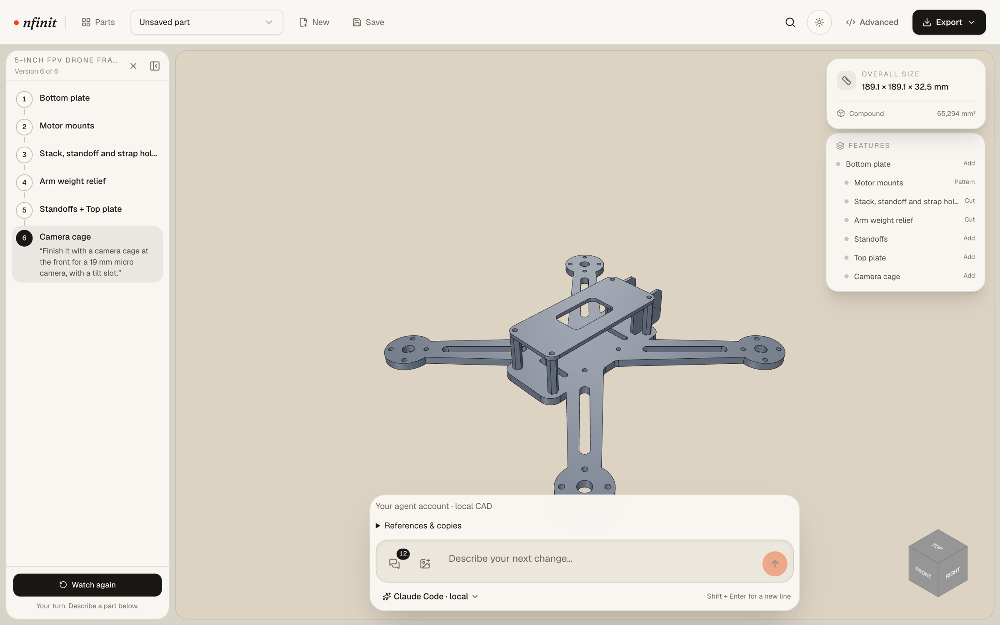

<div align="center">


# Nfinit

**From words to parts.** An open-source CAD workspace for Claude Code and Codex.

[](LICENSE)
[](https://github.com/MoayyadShahid/Nfinit/actions/workflows/cad-regression.yml)
[](https://github.com/MoayyadShahid/Nfinit/actions/workflows/frontend.yml)
[](CONTRIBUTING.md)

[Quick start](#quick-start) · [Features](#features) · [How it works](#how-it-works) · [Docs](#documentation) · [Contributing](#contributing)



</div>

Describe a part, attach reference pictures or an STL, and your coding agent
writes parametric [build123d](https://github.com/gumyr/build123d) code. Nfinit
builds it, measures it, and shows it in a 3D viewer. Refine it in chat or by
clicking a face, keep every revision, and export STEP or STL.

Everything runs on your machine. Nfinit needs no API keys or cloud accounts:
model usage goes through your own Claude Code or Codex login.

## Features

- **Bring your own agent.** Works with Claude Code and Codex through their
  official CLIs, using your existing login and usage limits.
- **Real, editable CAD.** Parts are parametric build123d (OpenCASCADE) code, so
  you can read, edit and reuse them.
- **Measured, not guessed.** The agent builds each part, checks volume, bounds
  and its own measurement checks, sees rendered views, and repairs until the
  part builds.
- **Point at what you mean.** Click a face to target it: "add a 10 mm boss on
  this face".
- **References in, files out.** Attach pictures, import STLs as solids or as
  references for a parametric rebuild, and export STEP or STL.
- **Full history.** Every change is a saved revision you can reopen or branch
  into a new copy.
- **Sandboxed.** Generated code runs in an isolated worker with no network and
  strict CPU, memory, time and file limits.

## Quick start

**You need:** macOS or Linux (WSL2 on Windows), Node.js 20.9+, Python 3.11 or
3.12, [Poetry](https://python-poetry.org/), and
[Claude Code](https://code.claude.com) or
[Codex](https://developers.openai.com/codex) installed and signed in. Ports 3000
and 8000 must be free.

```sh
git clone https://github.com/MoayyadShahid/Nfinit.git
cd Nfinit
npm ci
cd backend && poetry install && cd ..
npm run local
```

Open **http://127.0.0.1:3000/studio**, pick your agent in the model menu, and
describe a part. Try the demo parts first to see how a build comes together.

> [!TIP]
> If `poetry install` can't find a VTK or OpenCASCADE wheel for your platform,
> install them in a conda environment and point Nfinit at it:
> `NFNIT_PYTHON=/path/to/python npm run local`

## Using the studio

| To | Do this |
| --- | --- |
| Make a part | Describe it in the chat with real dimensions, e.g. "a 60 × 40 × 5 mm plate with four 4 mm holes 5 mm from each corner" |
| Change one area | Click a face in the viewport, then describe the change |
| Work from pictures | Attach, drop or paste PNG, JPEG, WebP or GIF images. Include a known dimension. |
| Start from an STL | Open **References & copies** and import it as a solid or as a reference |
| Go back in time | Open any earlier revision from the version list, or **Save as a new copy** |
| Edit the code | Open **Advanced** |
| Get files | **Export** as STEP or STL |

> [!WARNING]
> AI-generated parts can be wrong. Check every dimension, fit and strength
> requirement before you make or use a part.

## How it works

```
Browser ── Next.js studio ──► FastAPI backend ──► your agent CLI (Claude Code / Codex)
                                   │                     │
                                   │      Nfinit CAD tools (MCP): build_model
                                   ▼                     ▼
                              SQLite projects     sandboxed build123d worker
```

1. `npm run local` starts the backend and the studio on loopback only, with a
   random token shared between them.
2. Each run starts your agent CLI in a fresh temporary workspace, connected only
   to Nfinit's CAD tools.
3. The agent plans the change and calls `build_model`. Nfinit runs the code in
   the sandbox and returns validity, volume, bounds, measurement checks and
   rendered views. The agent repairs and rebuilds as needed.
4. The backend rebuilds the final code itself, then saves it as a new revision
   in `backend/data/nfinit.db`.

Prompts and reference images go to your agent's provider; CAD builds and
project files stay on your machine.

## Configuration

It works without configuration. Optional settings go in `backend/.env` (see
[`backend/.env.example`](backend/.env.example)):

| Variable | Purpose |
| --- | --- |
| `NFNIT_PYTHON` | Python interpreter the launcher uses for the backend |
| `NFNIT_DATABASE_PATH` | Where the SQLite database lives |
| `CAD_SANDBOX_*` | Sandbox time, memory and concurrency limits |
| `PATTERN_RAG_ENABLED` | Turn the bundled build123d pattern search on or off |

## Project layout

```
backend/    FastAPI API, agent adapters, CAD sandbox, evaluations (Python)
frontend/   Next.js studio and landing page (TypeScript)
scripts/    Local launcher
docs/       Architecture, local workspace, demos and security notes
```

## Documentation

- [Local workspace](docs/OPEN_SOURCE_WORKSPACE.md): agent connection, limits,
  reference pictures and STL import
- [Architecture](docs/ARCHITECTURE.md): sandbox, semantic topology, persistence,
  pattern search and evaluations
- [Demo parts](docs/DEMOS.md): how the example builds are made and rebuilt
- [Security](docs/SECURITY.md)

## Contributing

Contributions are welcome. Read [CONTRIBUTING.md](CONTRIBUTING.md), then run the
checks before opening a PR:

```sh
cd backend && poetry run python -m pytest -q
cd ../frontend && npx tsc --noEmit && npm run lint
```

The CAD benchmark replays recorded designs through the real sandbox, with no
model calls and no cost. Run it from `backend/`:

```sh
poetry run python -m evaluation.cli \
  --cases evaluation/cases/cad50.json --mode replay \
  --replays evaluation/replays/cad50.json \
  --output evaluation/reports/cad50.json
```

Bug reports and ideas go in [Issues](https://github.com/MoayyadShahid/Nfinit/issues).
For geometry bugs, include the prompt and the generated code.

## Roadmap

- Persistent agent sessions with approvals in the studio
- Independent, feature-specific acceptance tests
- Surface-deviation comparison for STL reconstructions
- Assemblies
- A signed desktop installer

## Acknowledgements

- [build123d](https://github.com/gumyr/build123d) and
  [OpenCASCADE](https://dev.opencascade.org/) do the geometry.
- The measure, render and repair loop is informed by
  [text-to-cad](https://github.com/earthtojake/text-to-cad)'s CAD guidance.

## License

[MIT](LICENSE). build123d, OpenCASCADE and other dependencies keep their own
licenses; the bundled build123d pattern corpus is Apache-2.0 (see
`backend/agent/retrieval/corpus/`).
